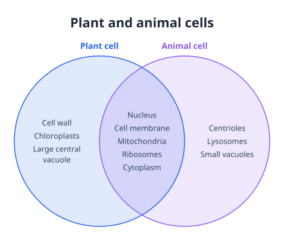

# SVG Diagram for Logseq

Create Venn diagrams, charts and other diagrams locally, then insert an SVG after the selected block. Your notes and diagram content are not sent to a server.

Select a block and choose **SVG Diagram: Create a diagram** from the command palette, or use the **SVG Diagram** slash command. Edit the fields, review the preview, and choose **Add to note**.

Example Venn diagram created and inserted with the plugin:

## Build

With Bun 1.4.3, run `bun install --frozen-lockfile --ignore-scripts` followed by `bun run --cwd apps/logseq package`. Load the `apps/logseq/dist` directory as an unpacked plugin in Logseq developer mode.
